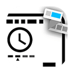

# 大屏时钟（Large-Screen-Clock）

ClassIsland 2.1 插件：在教室大屏上全屏显示时间、教室分贝、课程信息与提醒，并按课程统计吵闹次数。



## 功能

* **时钟与日期**：全屏时间（等宽数字、秒不抖动）、日期与星期。
* **教室音量**：实时分贝与静 / 良好 / 一般 / 吵闹 / 嘈杂五档；可按课程统计吵闹次数（起算底线、回落窗口、上课初期保护、计数规则）。
* **课程信息**：当前课、下节课与打铃时间、课程进度条；课后自动隐藏。
* **提醒与预警**：降雨、倒计时、文本提醒；CI 天气预警、摄像头占用提醒、地震预警。
* **组件化布局**：14 个可开关组件，各自调大小、位置、顺序与不透明度，关掉不占位；设置页顶部组件条可多行显示、点选即出该组件全部设置。
* **自定义图片**：可在大屏上叠一张自选图片（班徽、logo 等），大小、位置、不透明度与其它组件一致。
* **三种背景**：提取当前壁纸 / 纯色 / 自定义图片，默认提取壁纸；壁纸支持景深放大与模糊，解码结果带缓存。
* **开屏过渡**：每次显示都重演——压暗的桌面截图 → 交叉淡入背景（壁纸缓缓推近）→ 组件淡入；退出淡出，速率可调。
* **防御与恢复**：防休眠、最小化暂停、麦克风看门狗、内存保护；一键恢复默认设置。
* **始终置顶**：大屏窗口保持全屏与置顶，ClassIsland 顶部课表栏压在其上。

## 环境要求

* Windows 10 1809（17763）或更新版本
* ClassIsland 2.1+（`manifest.yml` 的 `apiVersion: 2.1.0.0`）
* 构建：.NET SDK 8.0+、PowerShell 7

## 依赖

`Large-Screen-Clock.csproj` 直接声明的 NuGet 包：

| 包 | 版本 | 用途 |
| --- | --- | --- |
| ClassIsland.PluginSdk | 2.1.0.1 | 插件 SDK（运行时由 ClassIsland 提供） |
| NAudio | 2.2.1 | 麦克风采样 |
| Microsoft.Windows.CsWin32 | 0.3.106 | 生成 Windows API P/Invoke（摄像头、截屏、壁纸、置顶） |
| Avalonia.Controls.ColorPicker | 11.3.17 | HSV 取色器 |

Avalonia、`Microsoft.Extensions.*` 由 PluginSdk 传递引入，插件包运行时不需要用户另装。

## 构建与打包

```powershell
pwsh -File ./build.ps1
```

默认打对外发布版（四位版本号）；`-Dev` 出五位开发版，`-NoRestore` 跳过还原，`-Clean` 先清理，`-Help` 查看全部参数。构建用命名互斥量 `Global\bsclock-build` 串行，发布链路是「本机构建 → 手动上传 cipx」，仓库不含 CI。

产物：

* `bin/<Configuration>/net8.0-windows/Large-Screen-Clock.dll` —— 插件程序集
* `bin/<Configuration>/net8.0-windows/manifest.yml` —— 已盖号的运行时清单
* `cipx/Large-Screen-Clock.cipx` —— 可直接安装 / 发布的插件包

`manifest.yml` 的 `version` 为对外版本（当前 `1.3.0.0`）；`apiVersion` 跟随编译所用 SDK（当前 PluginSdk 2.1.0.1 → `2.1.0.0`），升级 SDK 时同步修改。开发版五位号（`1.3.0.0.N`）宿主可加载，但更新检查不认，不会当正式更新分发。

## 致所有用户的一封信

> 从这个版本开始，大屏时钟插件不再添加新功能。这个项目最初只是给晚自习教室做一块安静的大屏时钟，后来一点点长出了音量统计、提醒、组件化这些能力。感谢每一位使用、反馈、帮忙排查问题的老师和同学。
>
> 愿你的教室安静一点，时间过得从容一点。
>
> —— sokumei，2026/10/31

## 作者与许可

* 作者：sokumei、MilkyWeighW
* 项目主页：https://github.com/MilkyWeighW/BigScreenClock-For-ClassIsLand2.0
* 许可证：GNU General Public License v3.0（详见 [LICENSE](LICENSE)）
* 免责声明：本插件为第三方 ClassIsland 插件，与 ClassIsland 官方无关；按「现状」提供，不附带任何担保。
